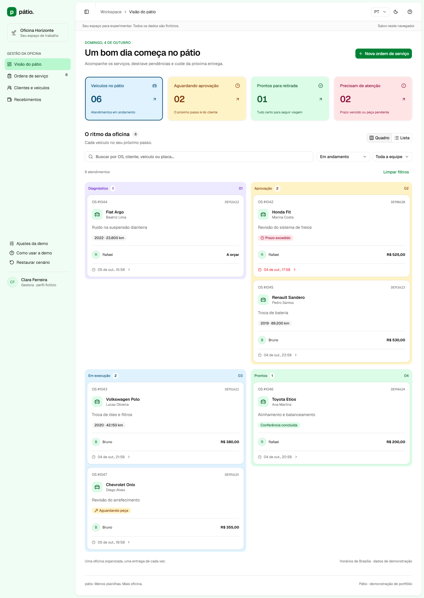

# Pátio

**Cada serviço, no seu ritmo.** Uma demonstração de gestão para oficinas independentes, com foco em design de interface, experiência de uso e regras de negócio verificáveis.



## Executar

Pré-requisitos: Node.js 24.x e npm. Validado no Windows com Node 24.21.0.

```powershell
cd "D:\code\patio"
npm ci
npm run dev
```

Abra [http://127.0.0.1:3002/demo](http://127.0.0.1:3002/demo). Não há credenciais, configuração de banco ou variáveis de ambiente obrigatórias. O servidor escuta apenas na máquina local.

Para o build de produção:

```powershell
npm run build
npm start
```

Pare o servidor anterior antes de iniciar outro na mesma porta. `Ctrl+C` encerra o processo iniciado no terminal. Use sempre a mesma origem: `localhost` e `127.0.0.1` têm armazenamentos diferentes.

## O que funciona

- Operação em quadro ou lista, pesquisa sem distinção de acentos, filtros por etapa e responsável. Indicadores abrem os conjuntos correspondentes; atrasos são calculados a partir da previsão.
- Criação de OS com cliente e veículo novos ou existentes, relato, quilometragem, responsável, previsão e checklist de entrada. O rascunho é salvo a cada alteração no navegador.
- Clientes com vários veículos e histórico de atendimentos; cadastro e edição de clientes e veículos. Atalhos abrem a OS ativa ou iniciam um atendimento com o cadastro selecionado, preservando rascunhos existentes.
- Orçamento com peças e mão de obra, quantidades decimais, preço e desconto por linha. Cálculos em centavos e revisões preservadas. Prévia para impressão/PDF pelo navegador.
- Aprovação ou recusa simulada, inclusive por item. Só os itens aceitos entram na execução. Revisar um orçamento aprovado exige nova aprovação e só é permitido antes de executar serviços ou receber valores.
- Execução com tarefas, bloqueio por peça, registro de chegada e duas conferências finais. Transições inválidas explicam o que precisa ser corrigido.
- Recebimentos parciais ou totais fictícios, saldo e entrega. Entregar com saldo exige motivo no perfil de gestora da demonstração. Pagamento após entrega continua possível.
- Histórico de eventos, alteração de prazo/responsável, cancelamento antes da execução, imagens ilustrativas de entrada.
- Persistência local validada, sincronização entre abas, detecção de revisão de orçamento desatualizada, exportação/importação JSON validada (até 2 MB), resumo antes da substituição e restauração explícita dos dados.
- Estados de carregamento, vazio, erro e restrição de acesso demonstráveis em Ajustes. Falha de gravação simulada preserva o formulário para nova tentativa.
- Layout responsivo, diálogos com foco contido e retorno ao acionador, navegação por teclado, abas com setas/Home/End, região de feedback e preferência por movimento reduzido.

## Idioma e aparência

Use o seletor **PT / EN** e o botão de sol/lua no cabeçalho. As mesmas opções estão em **Ajustes da demo → Aparência e idioma**. Português e inglês incluem navegação, formulários, mensagens, aprovação simulada, impressão e histórico gerado pela demo.

Idioma e tema ficam salvos neste navegador, sincronizam entre abas e sobrevivem à restauração do cenário. A troca não altera ordens, recebimentos ou rascunhos. Textos próprios digitados pelo usuário permanecem como foram escritos; descrições conhecidas do cenário têm tradução de apresentação. Valores continuam em **reais (BRL)**, com formatação no idioma escolhido, e datas de exibição mantêm o fuso **America/Sao_Paulo**.

Os temas claro e escuro usam a mesma identidade visual, incluindo estados de erro, pendência e sucesso. A impressão usa o tema claro para legibilidade no papel.

## Roteiro de três minutos

1. Na operação, abra **OS #1042 · Honda Fit**.
2. Em **Orçamento**, abra a aprovação simulada. Desmarque um item e aprove os restantes.
3. Em **Execução**, conclua os itens aprovados e marque as duas conferências. Conclua a execução.
4. Em **Recebimentos**, registre um valor fictício; depois registre a entrega. Experimente a exigência de motivo se restar saldo.
5. Atualize a página, consulte o histórico e alterne para celular. Restaure a demo para explorar novamente.

Para demonstrar recuperação: em **Ajustes da demo**, ative a falha na próxima gravação. Navegue pelos links internos até uma OS, revise um orçamento e tente salvar duas vezes. A primeira tentativa falha; os campos permanecem preenchidos.

## Comandos de qualidade

```powershell
npm run lint
npm run typecheck
npm test
npm run test:e2e
npm run format:check
npm run build
```

Os testes E2E usam Microsoft Edge por padrão, instalado nesta máquina. Para usar Chrome instalado:

```powershell
$env:PLAYWRIGHT_CHANNEL = "chrome"
npm run test:e2e
```

O Playwright inicia um servidor temporário se a porta 3002 estiver livre e reutiliza um servidor existente. Os cenários usam contextos de navegador isolados; não alteram os dados da sua sessão pessoal. Relatório HTML em `playwright-report/index.html`; capturas selecionadas em `docs/screenshots/`.

## Arquitetura

Next.js App Router, React, TypeScript, Zod, **shadcn/ui (preset Nova, base Radix)**, Tailwind CSS 4, next-themes, Sonner e Lucide. Componentes oficiais gerados pelo CLI ficam em `src/components/ui/`; `patio-ui.tsx` contém apenas composições do domínio sobre esses componentes. O tema Green do shadcn, sobre a base neutral, usa variáveis semânticas em `globals.css` e modos claro/escuro com a classe `.dark`. A fonte Geist é baixada por `next/font` durante o build e servida localmente. Vitest para domínio e Playwright + axe para interface.

Para adicionar componentes, use `npx shadcn@latest add <componente>`. A configuração está em `components.json`. Cores, bordas e raios são definidos pelos tokens do tema; layouts usam utilitários Tailwind. O CSS antigo foi removido. Novas telas devem compor os componentes existentes em vez de recriar botões, campos, diálogos ou navegação.

```text
src/app/                   rotas, layout, estilos e tratamento de erro
src/components/            shell e componentes compartilhados
src/features/orders/       operação, cadastro, entrada, execução e entrega
src/features/quotes/       edição, versões, aprovação simulada e impressão
src/features/workspace.tsx clientes, recebimentos e ajustes
src/lib/domain.ts          esquemas, cálculos e transições puras
src/lib/demo-store.tsx     adaptador local e contexto persistente
src/lib/seed.ts            seis atendimentos sintéticos
tests/unit/                contratos de domínio
tests/e2e/                 jornadas, recuperação, layout e acessibilidade
```

Decisões e limites estão em [Arquitetura](docs/arquitetura.md). As evidências e o ambiente de teste estão em [Validação](docs/validacao.md).

## Publicação na Vercel

**Demo pública:** [patio-gamma.vercel.app](https://patio-gamma.vercel.app). Publicada e acessível sem login.

O app não exige banco nem segredos. Use o preset Next.js, Node 24.x, `npm ci` e `npm run build`. O diretório raiz é `outputs/patio` se importar este repositório completo, ou `./` se publicar apenas a pasta do app.

Dentro da pasta do app, `npx vercel login`, `npx vercel` e, depois de conferir a prévia, `npx vercel --prod`. A pasta já está vinculada ao projeto `patio` na Vercel. Novas versões podem ser publicadas com `npx vercel --prod`; não há repositório Git remoto conectado para deploy automático.

Veja [Publicação na Vercel](docs/publicacao-vercel.md) para configuração e conferência da URL, e [Revisão para portfólio](docs/revisao-portfolio.md) para a matriz de funcionalidades e o que seria necessário para uso real.

Para testar o build de produção, execute `npm run build`, defina `$env:PLAYWRIGHT_PRODUCTION = "1"` e rode `npm run test:e2e`. O servidor isolado usa a porta 3003. Depois, remova a variável com `Remove-Item Env:PLAYWRIGHT_PRODUCTION`.

## Limites da demonstração

Este P0 é uma demonstração de front-end funcional dentro da arquitetura planejada para o produto full stack. **Ainda não há backend de negócio**, autenticação, permissões reais, banco compartilhado, RLS, uploads, estoque, agenda, mensageria, pagamentos, nota fiscal nem operação comercial. A demo está publicada na Vercel. O “portal” é uma janela local de simulação; não é um link externo seguro.

Os dados não saem do navegador. Limpar o armazenamento ou usar outro navegador inicia outro cenário. Use somente informações fictícias. A exportação JSON pode ser importada em Ajustes da demo para recuperar ou transportar o cenário entre navegadores. O arquivo é validado antes da confirmação; a substituição mantém idioma e tema.

LocalStorage não fornece transações entre abas. A demo detecta versões divergentes e sincroniza mudanças usuais, mas não promete consistência para gravações estritamente simultâneas. Sem garantias de backup, auditoria inviolável ou operação offline completa. No P1, as regras devem ser revalidadas no servidor com autorização, transações e restrições no banco.

O nome Pátio é provisório, sem verificação de marca. As ilustrações, valores, clientes e resultados são fictícios. O projeto não apresenta métricas comerciais de oficinas reais.
